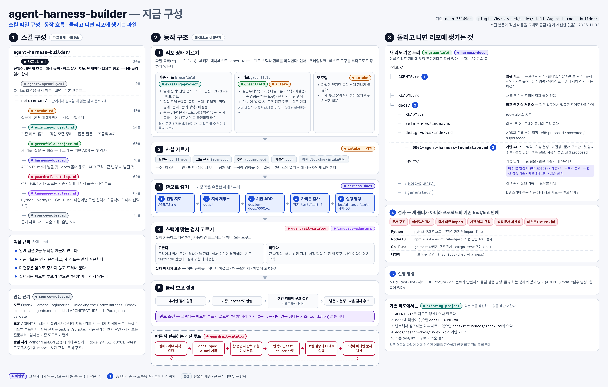
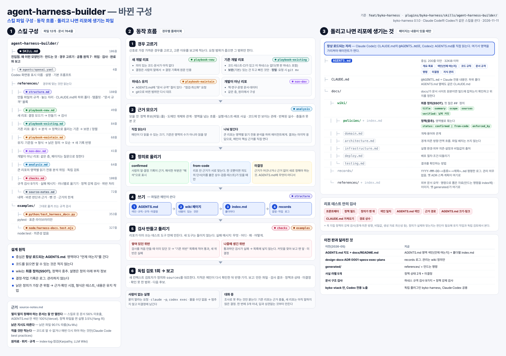

# byko-harness 0.1 — 리포 하네스를 "항상 읽히는 색인 + 최종 정의 wiki"로 다시 짰다

2026-11-11. 리포 하네스를 만드는 스킬 `agent-harness-builder`를 다시 썼다. byko-stack 안에서 Codex에만 보이던 이 스킬을 독립 플러그인 byko-harness로 옮겨 Claude Code와 Codex가 함께 쓰게 했다. 이 문서는 세 가지를 적는다. 무엇을 왜 바꿨는지, 어디까지 확인했는지, 어떻게 쓰는지다. 확인한 것과 확인하지 못한 것을 나눠 적는다.

## 먼저 볼 것: 확인하지 못한 것

| 무엇 | 상태 | 이유 |
|---|---|---|
| Codex에서의 실제 실행 | 매니페스트·마켓플레이스 등록까지만 확인 | 행동 평가는 Claude Code(`claude -p`)로만 돌렸다 |
| 내려받은 공개 리포에서 생성된 테스트의 실행 | 실행하지 않음 | 이 환경이 내려받은 코드의 설치·실행을 막는다. 대신 신뢰하는 바깥 검사기로 규격을 판정했고, 생성된 테스트 파일은 그 리포의 ruff 설정으로 lint·format 검사만 했다 |
| 큰 리포의 영역별 병렬 분석 | 실제로 갈라진 사례 없음 | 평가 리포가 모두 작아 스킬이 직접 읽는 쪽을 골랐다. 그 판단 자체는 의도대로다 |
| 반복 실행 | 시나리오마다 1회 | 아래 비교는 모두 단일 실행 사실이다. 향상을 일반화하지 않는다 |
| 출하 전 검토 뒤의 새 리포·기존 리포·개발 외 리포 | 다시 돌리지 않음 | 검토 뒤 바뀐 것은 검사기 코드(패키지 테스트로 확인)와 하위 폴더 AGENTS.md·CLAUDE.md 규칙이다. 평가 리포에는 하위 AGENTS.md가 없어 이 규칙이 행동을 바꾸지 않는다. 가장 많이 바뀐 유지 시나리오만 최종 판으로 다시 돌렸다 |
| 보고 언어 한 줄 | 다시 돌리지 않음 | 2차 실행 하나가 한국어 요청에 영어로 보고해서 넣은 줄이다 |
| Windows, vitest·jest에서의 실제 실행 | 실행하지 않음 | 이 환경에 없다. 코드상 경로 처리는 `pathlib`·`path` 기준으로 맞췄다 |
| 괄호가 든 링크 대상(`file%20(1).png` 등) | 지원하지 않음 | 드문 형식이라 다음 판으로 넘겼다. 그런 링크는 검사가 "없다"고 잘못 실패한다 |
| 이 리포 루트에서 `pytest`나 `node --test`를 그냥 돌리는 경우 | 예시 검사 파일이 수집되어 실패할 것으로 본다(추론) | 이 리포의 테스트는 플러그인별 `unittest` 명령이라 게이트에는 영향이 없다 |

## 왜 바꿨나

이전 판(2026-05)은 2026년 2월 OpenAI의 "Harness engineering" 글을 바탕으로 만들었다. 그 뒤 9개월 동안 모델과 에이전트 도구가 크게 바뀌었다. 목표는 개선을 위한 개선이 아니었다. 기술이 바뀌어 낡은 부분만 바꾸고, 잘 되던 것은 두는 것이었다.

실사용에서 관찰된 문제는 다음과 같았다.
- 에이전트가 하네스 문서를 잘 열어 보지 않았다.
- 정책 판단을 헛짚었다.
- 코드가 커지면서 좁은 코드만 보고 주변 맥락을 놓쳤다. 넓게 보라고 하면 너무 오래 걸렸다.
- 리포 안의 공통 구조를 매번 다시 분석해야 했다.

조사해 보니 이 관찰과 맞는 근거가 있었다.

- **열지 말지 스스로 정해야 하는 문서는 잘 열리지 않는다.**
  - Vercel(2026-01): 스킬로 둔 문서는 56% 실행에서 호출되지 않았다. AGENTS.md 안에 둔 문서 색인은 통과율 100%였다.
  - Yang 외(arXiv 2607.26819): 규칙이 자동으로 읽히는 파일에 없을 때 정책 파일을 연 실행은 3.5%였다. 위반 248건 중 242건이 정책 파일을 열지 않은 채 일어났다.
- **에이전트는 읽힌 지시를 따르고, 낡은 지시도 따른다.**
  - Xu·Wu(arXiv 2610.30571): 낡은 지시 파일을 90.1% 따랐다.
  - 같은 연구에서 우선순위 문장 하나로 코드를 따르는 비율이 4.2%에서 91.4%로 올랐다.
- **적을 것만 적는다.** Claude Code 공식 권장은 코드를 읽어서는 알 수 없거나 매 세션 다시 찾아야 하는 것만 적는 것이다. 아키텍처·파일 배치 서술은 "그만 써도 되는 것"으로 분류됐다.
- **원자료와 위키를 나눈다.** Karpathy의 LLM Wiki(2026-04)는 원자료, 에이전트가 유지하는 위키, 규격을 나눈다. 색인을 먼저 읽게 하고, 점검으로 모순·낡음·고아 파일을 찾는다. 사용자의 판단도 같았다. ADR·스펙은 쌓이기만 하는 로그이고, 관리할 수 있는 핵심은 정책이다.

근거 전체와 한계는 스킬의 [source-notes.md](../../plugins/byko-harness/skills/agent-harness-builder/references/source-notes.md)에 있다. 한계도 함께 적었다. 컨텍스트 파일의 효과는 연구마다 엇갈리고, 상당수가 2026년 예비 논문이다.

## 무엇이 바뀌었나

이전 판의 구성이다. 사용자가 요청해 2026-11-03에 그린 그림이다.



바뀐 구성이다.



| 구분 | 이전 | 지금 |
|---|---|---|
| 중심 | AGENTS.md는 지도. 세부는 에이전트가 docs에서 찾아 읽음 | AGENTS.md에 영역 색인과 영역마다 "언제 여는지"를 둔다. 코드 규칙, 문서 규격, 명령, 미결정, 지식 관리도 둔다. CLAUDE.md는 `@AGENTS.md`로 같은 파일을 읽게 한다 |
| 지식 | `docs/README.md`, design-docs(ADR 0001), specs, exec-plans, generated | `docs/wiki`가 최종 정의(SSOT)이고 정책이 중추다. 프론트매터(title·summary·scope·sources·verified)가 필수이고, 첫 절은 "## 정의"다 |
| 기록 | ADR·스펙을 관리 | `docs/records/YYYY-MM-DD-<종류>-<제목>.md` 로그. 관리 의무가 없다 |
| 참고 자료 | references, generated 따로 | `docs/references` + index.md. 생성 자료는 만드는 명령을 적는다 |
| 사실 구분 | 라벨 5개(confirmed·from-code·recommended·open·blocking) | 정책 상태 2개(confirmed·from-code)와 AGENTS.md "미결정". 추천은 문서에 쓰지 않고 보고로 간다 |
| 검사 | 문서 구조 검사 | 리포 테스트 도구 안의 하네스 규격 검사 9가지 + 꼭 지킬 정책의 강제 검사. Python·Node 예시를 그대로 옮겨 쓴다 |
| 흐름 | 단일 흐름(기존/새/모호함) | 경우별 플레이북 4개: 새 리포, 기존 리포(보완·정렬), 유지, 개발이 아닌 리포 |
| 질문 | 대화형을 가정 | 사람이 없는 실행이면 멈추지 않고 미결정으로 남긴다. 대화 중이면 정책·의도만 3개 이내로 묻는다 |
| 위치 | byko-stack 안 `codex/skills/`, Codex에만 노출 | 독립 플러그인 byko-harness, Claude Code·Codex 공용. 스킬 이름은 그대로다 |

뺀 것과 그 이유도 [source-notes.md](../../plugins/byko-harness/skills/agent-harness-builder/references/source-notes.md)의 "뺀 것"에 적었다. 기초 ADR, 자율 수준 질문, 스펙 추적 검사 등이다.

플러그인 정리:
- byko-stack은 0.5.2로 올렸다. 여기서 `codex/`와 `.codex-plugin/`을 지웠고, 이제 Codex에 노출하지 않는다.
- Codex 마켓플레이스의 byko-stack 항목은 byko-harness로 바꿨다.
- Claude 마켓플레이스에는 byko-harness를 더했다.

## 어떻게 정했나

설계는 사용자와 한 단계씩 정했다. 주요 결정은 이렇다.
- **AGENTS.md:** 항상 로드되는 중심이다. 모든 것을 색인하지 않고 영역 단위로 가리킨다. 세부 목록은 폴더의 index.md가 맡는다.
- **wiki:** 정의가 원본이고, 이유·설명은 정의 아래의 부차 정보다.
- **문서 규격:** AGENTS.md에 두고, 리포의 테스트 도구로 검사한다.
- **경우:** 새 리포, 기존 리포(기본은 보완, 요청하면 정렬), 유지, 개발이 아닌 리포 모두가 범위다. 개발이 아닌 리포는 원리에서 구성하고 앞으로 고도화한다.
- **판단:** 큰 리포는 병렬 분석으로 판단한다. 사람에게는 근거가 충돌할 때만 묻는다.
- **검증 방식:**
  - 새 리포는 가상 시나리오로 확인한다.
  - 기존 리포는 작고 인기 있는 공개 리포를 임시로 받아 로컬에서 하네스를 만들어 본다.
  - 검증 피드백도 스스로 한다.

구현 원칙은 이렇다.
- **skill-creator의 방식을 따랐다.**
  - 이유를 설명했다.
  - 필요한 것만 읽게 나눴다(progressive disclosure).
  - 이전 판과 같은 시나리오로 비교했다.
- **description을 강하게 쓰라는 조언은 따르지 않았다.** byko-stack에서 과호출을 겪었다. 대신 요청 유형과 경계를 적었다.

## 확인한 것

### 기계 검사

| 확인 | 결과 |
|---|---|
| 패키지 테스트(`python3 -m unittest discover -s plugins/byko-harness/tests`) | 20개 통과. 매니페스트 일치, 스킬 발견, 패키지 안 링크, 검사 예시(고장 사례 25가지, 허용 변형 13가지, 경로 상수를 바꾼 사본, 루트 자동 탐색, 경고를 오류로 다루는 설정, macOS NFD 이름). Python과 Node가 사례마다 같은 검사에서 실패하는지도 비교한다 |
| 새 테스트가 실제로 잡는지 | 2차에서 더한 사례는 1차 검사기에서 8건 실패한다. 출하 전 검토 뒤 더한 사례는 직전 판 검사기에서 Python 14가지, Node 8가지 경우가 실패한다(Node 고장 사례는 직전 판의 테스트 이름이 달라 비교에서 뺐다) |
| `claude plugin validate --strict` | byko-harness, byko-stack, 마켓플레이스 통과 |
| 기존 게이트 | byko-stack-codex 테스트 통과 |

### 행동 평가

- **실행 조건:** Claude Code 2.1.322, `claude-opus-5-5`, effort high, `claude -p`(사람이 없는 실행).
- **인증:** 구독 인증(`apiKeySource none` 확인)이다.
- **허용 도구:** 파일 읽기·쓰기, git 조회만 허용했다.
- **공개 리포:** 공개 리포에서는 코드를 실행하지 않았다.
- **판정 방법:** 결과는 신뢰하는 바깥 검사기와 사전에 적은 기준으로 판정했다.
- **수치 단위:** 시간은 벽시계 초, 토큰은 결과 이벤트의 출력 토큰이다.

| 시나리오 | 이전 판 | 새 판 1차 | 새 판 2차 | 판정 |
|---|---|---|---|---|
| s1 새 리포. 가상 "agent-memory" 서버. 정해진 스택·정책 3개·미정 2개를 요청에 담음 | 747초, 81턴, 81K. 파일 33개: 검사 도구 모듈 12개, ADR 3개, 스펙, 앱 골격 | 213초, 32턴, 24K. 파일 11개. 바깥 검사 실패 0 | 273초, 32턴, 25K. 파일 11개. 바깥 검사 실패 0. 요청 원문 인용과 "해석" 절 분리, 앱 골격 없음 | 통과. 템플릿 부풀림이 사라짐 |
| s2 기존 리포. pallets/itsdangerous `672971d`(별 3,142, BSD-3) | 1,691초, 105턴, 125K. `agent-docs/`, ADR 0001, 가드레일 테스트 3개 | 925초, 54턴, 70K. wiki 4개 페이지와 정책 3개(from-code), 정책 강제 테스트, 근거 있는 미결정 6개. 독립 검토 1회 | — | 통과. 바깥 검사 실패 0, 생성 테스트 ruff 통과 |
| s3 유지. s2 결과에 드리프트 커밋 5개를 심음 | — | — | 286초, 55턴, 25K. 사전 기준 5/5. 최종 판(출하 전 검토 반영)으로 다시 돌린 결과: 154초, 34턴, 16K, 5/5. 다음 기준점이 될 유지 기록을 남겼고, 바깥 검사(최종 검사기) 실패 0 | 통과 |
| s4 개발이 아닌 리포. 책 원고 3장, 일부러 모순과 표기 위반을 심음 | — | 291초, 31턴, 32K. 정산 주기 T+1과 D+2의 충돌을 미결정으로, 존댓말 위반은 기존 위반 목록으로 | — | 통과. 바깥 검사 실패 0 |
| 발견. 슬래시 명령 없는 자연어 요청 | — | — | 써야 할 요청 3/3에서 스킬 호출, 쓰지 말아야 할 요청(오타 수정, 기능 추가) 0/2 | 통과 |

s3에서 심은 드리프트와 결과:
- **일관된 동작 변경:** 알 수 없는 키 유도 방식에 대한 오류를 `TypeError`에서 `ValueError`로 바꾸고, 코드·테스트·docstring·CHANGES를 함께 고쳤다. 스킬은 domain 정의를 새 동작으로 고치고 `verified`를 올렸다.
- **정책 위반:** 모듈 수준에서 `hashlib.sha1`을 읽게 했다. 정책은 "import 시점에 읽지 않는다"이다. 스킬은 이렇게 처리했다.
  - 코드, 정책, 검사를 고치지 않았다.
  - 커밋을 짚어 보고서 맨 앞과 미결정에 올렸다.
  - "허용 목록에 넣어 통과시키지 말라"고 적었다.
- **색인 없는 참고 자료:** references index를 만들고 AGENTS.md 색인에 넣었다.
- **필드 누락:** 고쳤다.
- **새 결정 기록:** 정의에 반영했다. 해소된 미결정은 "결정과 docstring 불일치"로 바꿨다.
- **덤으로 고친 것:** 1차에서 만든 검사기의 숨은 버그다. 그 리포는 경고를 오류로 다루는데, 200줄 경고가 그 설정에서 실패로 바뀌던 문제다.

### 평가에서 찾아 고친 것

1차 실행과 스킬 본문의 독립 검토에서 나온 지적 가운데, 사실로 확인된 것을 2차에 반영했다.
- **유지:**
  - 사람이 정한 정의는 코드가 달라도 고치지 않는다. 리포 자료가 일관되게 바뀐 정의는 새 동작으로 고친다. 판단 기준은 근거가 어디서 왔는가다.
  - 새 기록을 찾는 기준점을 정했다. 마지막 유지 기록, 없으면 가장 오래된 `verified`다(검토 뒤 바꿈). 날짜만 있거나 커밋이 사라졌을 때의 대체 방법도 정했다.
  - 페이지끼리 모순되는지 확인한다.
- **위반 처리:** 검사를 처음 만들 때 이미 쌓여 있던 위반은 "기존 위반" 목록으로 통과시킨다. 통과하던 검사가 새로 실패하면 목록에 넣지 않고, 실패한 채로 보고한다. 검사가 막으려던 변경을 숨기지 않기 위해서다.
- **정책으로 올리는 기준:**
  - 근거가 한 곳뿐이면 의도의 단서가 있을 때만 올린다. 단서는 이름 붙은 상수, 검증 코드, 테스트 같은 것이다.
  - 사람의 결정과 코드에서 정리한 규칙이 한 페이지에 섞이면 상태는 from-code로 두고, 사람의 결정은 기록을 링크한다.
- **사람 유무:** 사람이 없는 실행의 신호를 정했다. 묻지 말라는 요청, `claude -p`, `codex exec`, 물을 수단이 없는 경우다.
- **위임 기준:** 영역의 수가 아니라 읽을 양으로 정한다. 하위 에이전트는 파일을 남기지 않는다.
- **기존 리포:**
  - 기존 CLAUDE.md에는 `@AGENTS.md`를 더한다. 공통 지침은 보완 모드에서는 "옮길 후보"로 보고하고 정렬 모드에서 옮긴다(검토 뒤 바꿈).
  - 32KiB를 넘는 AGENTS.md는 세부를 wiki로 옮긴다.
  - 옛 판 하네스를 옮기는 대응표를 두었다.
  - 반복된 실수를 정책 후보로 모은다.
  - docs/가 문서 사이트 원본이면 하네스 파일이 공개 사이트에 실리지 않는지 확인한다. 이전 판 실행이 같은 리포에서 짚은 점이다.
- **새 리포:** 경계·흐름 질문을 더했다. 요청 원문을 인용하고 해석은 분리한다. 검사에 필요한 최소 설정만 만들고 앱 골격은 만들지 않는다.
- **검사기:** 다음을 고쳤다.
  - `경로:줄` 근거
  - `/`로 시작하는 링크
  - references 하위 폴더 색인
  - 경고를 오류로 다루는 pytest 설정
  - Node의 `%` 경로
  - unittest·vitest·jest로 옮기는 법도 적었다.

### 출하 전 독립 검토

커밋 전에 self-review를 했다.
- **검토자:** 결론을 알리지 않은 독립 검토자 2명이 각자 봤다. 한 명은 목적·계약·호환성을, 다른 한 명은 적대적 검증과 테스트 신뢰성을 맡았다.
- **확인:** 지적은 메인이 공식 문서, CLI, 직접 재현으로 다시 확인한 뒤 반영했다.

반영한 것:
- **기존 Codex 설치자(검토자 재현):** Codex에서 byko-stack을 켜 둔 사용자는 마켓플레이스가 바뀐 뒤에도 캐시에 남은 옛 `agent-harness-builder`가 새 스킬과 함께 로드된다. README와 이 문서에 `codex plugin remove byko-stack@byko-plugins` 안내를 넣었다. 재현 환경은 격리한 `CODEX_HOME`과 codex-cli 0.167.0이다.
- **Claude Code의 하위 폴더 AGENTS.md(공식 문서로 확인):** 루트에 CLAUDE.md가 생기면 Claude Code는 하위 폴더의 AGENTS.md를 읽지 않는다. 하위 AGENTS.md 옆에 `@AGENTS.md`를 담은 CLAUDE.md를 두는 규칙과 그 검사를 넣었다. 코드 블록·인라인 코드 안의 가져오기는 무시되므로 검사도 그렇게 본다.
- **검사가 아무것도 보지 않고 통과하던 경로:**
  - 하위 폴더 AGENTS.md를 루트로 잡던 문제. 이제 `.git`을 먼저 찾는다.
  - 경로 상수가 리포와 다를 때. 새 검사 9번이 AGENTS.md가 wiki 경로를 말하는지 본다.
  - wiki 경로만 바꾸면 정책 검사가 꺼지던 문제. 이제 정책 경로를 wiki 경로에서 끌어낸다.
  - Node에서 경로 끝 `/`가 있으면 색인 검사가 꺼지거나 끝나지 않던 문제.
- **잘못 실패하던 경우:** BOM, `<…>`·제목이 붙은 링크, 인라인 코드 안의 예시 링크, `.obsidian` 같은 점 폴더, macOS NFD 한글 파일 이름, `@./AGENTS.md`.
- **판정 차이와 빈틈:**
  - Python과 Node의 200줄 판정을 맞췄다.
  - 경고를 오류로 다루는 pytest에서 알림이 사라지던 문제를 고쳤다.
  - `verified`를 목록으로 쓰면 형식 검사를 건너뛰던 문제를 고쳤다.
  - 어디서도 링크되지 않은 하위 색인을 잡는다.
- **지침:**
  - 유지 기준점.
  - 마무리 조건과 위반 처리의 모순.
  - "정리한다"처럼 삭제로 읽히던 문구.
  - 기존 AGENTS.md를 줄이는 기준.
  - 질문 범위. 기존 리포는 근거 충돌만 묻는다.
  - 보완 모드에서 CLAUDE.md 내용을 옮기지 않는 것.
  - 결정 기록 인용 속 비밀값 가리기.
  - 개발 외 리포의 산출물 폴더와 공개 위치.
- **패키지 테스트:** 검사마다 고장 사례 하나뿐이라 세부 규칙을 지우면 통과하던 것을 보강했다. 9개에서 20개가 되었고, 두 언어의 판정을 검사 단위로 비교한다.

넘긴 것은 위 "먼저 볼 것" 표에 있다. 괄호가 든 링크 대상, Windows·vitest·jest 실제 실행이다.

## 남은 것

다음 판 후보다.
- Codex(`codex exec`)에서 같은 시나리오 실행
- 코드 실행이 허용된 환경에서 생성된 테스트와 기존 게이트를 실제로 돌리는 평가
- 영역이 많은 큰 리포에서 병렬 분석이 갈라지고 합쳐지는지 확인
- 개발이 아닌 리포 플레이북 고도화
- byko-stack-codex가 리포의 기존 specs를 두고 별도 작업 폴더를 만드는 현상은 별도 작업으로 다룬다(이번 범위 밖)

## 쓰는 법

### 설치

Claude Code:
```
/plugin marketplace add bykolee0/byko-stack
/plugin install byko-harness@byko-plugins
```
이미 마켓플레이스를 등록했다면 `/plugin marketplace update byko-plugins` 뒤에 설치한다.

Codex: 이 저장소의 `.agents/plugins/marketplace.json`을 로컬 마켓플레이스로 등록하고 byko-harness를 설치한다. 예전에 byko-stack을 켜서 이 스킬을 쓰던 경우에는 먼저 옛 플러그인을 지운다. 지우지 않으면 캐시에 남은 옛 스킬이 함께 로드된다. 목록에 보이지 않아도 제거 명령은 동작한다.
```
codex plugin remove byko-stack@byko-plugins
codex plugin add byko-harness@byko-plugins
```

### 부르기

| 하고 싶은 일 | Claude Code | Codex |
|---|---|---|
| 새 리포·기존 리포에 하네스 만들기 | `/byko-harness:agent-harness-builder 이 리포에 하네스를 구성해줘` | `$agent-harness-builder 이 리포에 하네스를 구성해줘` |
| 기존 문서까지 이 구조로 옮기기(정렬) | `… 기존 문서도 이 구조로 맞춰줘` | 같음 |
| 점검·최신화(유지) | `… 하네스를 점검해서 최신으로 맞춰줘` | 같음 |
| 일부만 | `… AGENTS.md만 정리해줘` | 같음 |

자연어로 "하네스 만들어줘", "AGENTS.md 정리해줘", "하네스 점검해줘"라고만 해도 스킬이 골라진다(평가 3/3).

### 결과를 쓰는 법

- 에이전트는 AGENTS.md를 항상 읽고, 색인의 "언제 여는지"를 보고 wiki 페이지를 연다. 사람도 같은 순서로 보면 된다.
- 결정이 나면 `docs/records/`에 날짜 기록을 남기고, 지금 기준은 wiki 정의에 반영한다.
- AGENTS.md "미결정"은 사람이 정할 목록이다. 정하면 기록을 남기고 그 항목을 지운다.
- 하네스 규격 검사는 리포의 테스트 명령으로 돈다. 실패 메시지가 무엇·어디·왜·어떻게를 알려 준다.
- 코드가 많이 바뀐 뒤나 릴리스 전에 "하네스 점검"을 부른다. 유지 작업은 `verified` 커밋 이후 바뀐 범위만 다시 대조한다.
